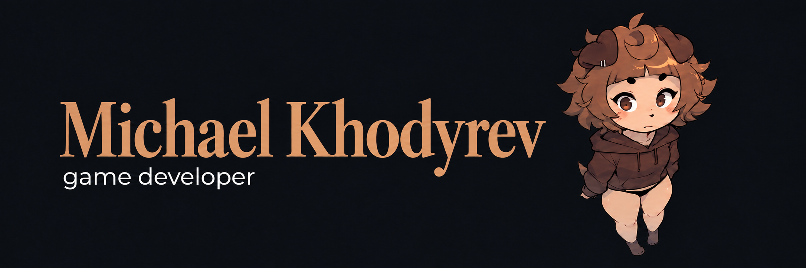

  &nbsp;&nbsp;
  &nbsp;&nbsp;
  

## Projects

**[Mad-Slime](https://github.com/otecGlinomes83/Mad-Slime)** 
A hypercasual game for Yandex Games.

**[MazeHell](https://github.com/otecGlinomes83/MazeHell)** 
A fast-paced, Doom-inspired 2.5D shooter with procedurally generated levels, developed for my academic internship.

## About me

I make games in Unity, working on gameplay, shaders, and 2D and 3D prototypes.
